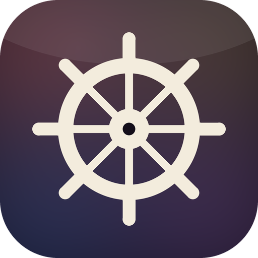

  

<h1 align="center">PilotFoundry</h1>

<strong>Small tools, forged with care.</strong>

PilotFoundry is a small foundry for focused macOS utilities. Each tool should
earn its place in the menu bar, stay understandable, and respect the user's
permissions and data.

## Projects

- [SwitchPilot](https://github.com/PilotFoundry/switchpilot) — a small,
  privacy-first macOS menu bar utility for keep-awake, dark mode, screen saver,
  lock screen, display sleep, microphone mute and screen cleaning. English,
  简体中文, 繁體中文 and 日本語 UI; source and an ad-hoc universal download are
  available.

## Principles

- Few controls, carefully made.
- Public APIs and a small permission surface.
- No telemetry, no privileged helper and no automatic TCC changes.
- Honest unsupported states, visible status and recoverable actions.
- One visual language across the tools: rounded, calm, and built for macOS.

## Links

- [SwitchPilot source](https://github.com/PilotFoundry/switchpilot)
- [SwitchPilot releases](https://github.com/PilotFoundry/switchpilot/releases)
- [License](https://github.com/PilotFoundry/switchpilot/blob/main/LICENSE)

The organization mark is a simplified ship's helm. The collection palette
lives in the dark field; the helm itself stays ivory so it reads at small sizes.
